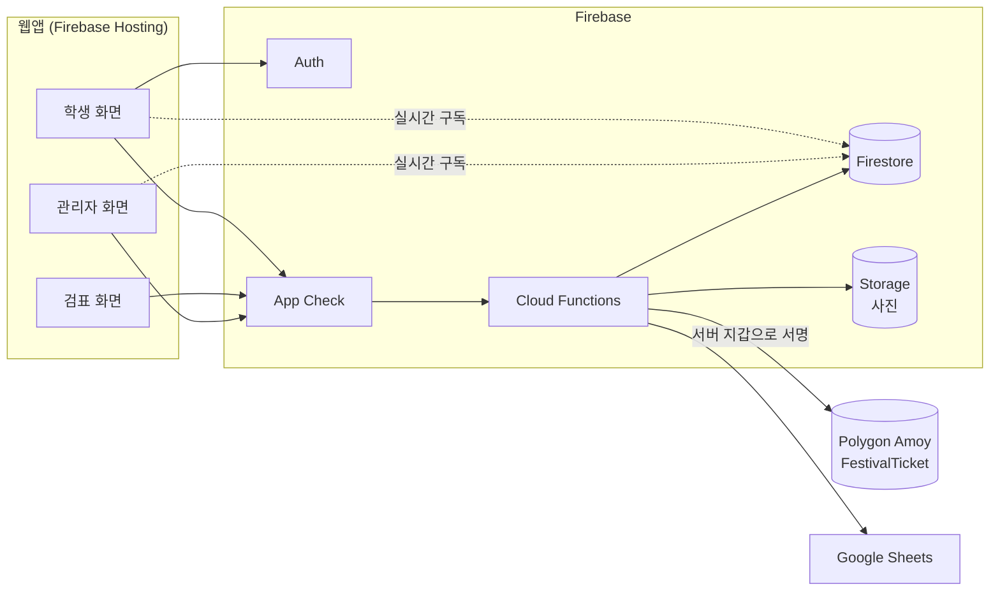

# 기술 설계 · 이후 개발 계획

프로토타입(11/3 제출)의 범위, 역할, 타임라인, 데모 시나리오는 [프로토타입 개발 계획 (내일 제출)](https://app.notion.com/p/40c623493b2d8005bc95c6cc349709a8)을 따른다. 이 문서는 그 계획에 없는 기술 세부와 프로토타입 이후(11/4~11/6) 설계를 다룬다. 기획 기준은 [최종 기획 (수정안)](https://app.notion.com/p/40c623493b2d80649458f48269ef87b6)이다.

## 1. 프로토타입 보완 사항

개발 계획에는 없지만 오늘 작업에 영향을 주는 것만 적는다.

### 1.1 시작 전 확인

- **Blaze 요금제**: QR 토큰 교체와 검표 검증을 서버에서 하려면 Cloud Functions가 필요하고, Functions는 Blaze 요금제에서만 배포된다. 카드 등록이 필요하지만 데모 규모는 무료 사용량 안이다. Firebase 프로젝트를 만들 때 같이 전환한다.
- **로그인**: 프로토타입은 구글 로그인만 쓴다. 데모는 팀원의 학교 구글 계정으로 한다. 학교 메일이 Google이 아닌 학교는 2.3의 학교 메일 인증으로 해결한다.
- **학교 도메인 제한**: 구글 로그인만으로는 개인 Gmail도 들어온다. 서비스를 특정 학교로 한정하지 않으므로, 허용 도메인은 행사마다 `events.allowedDomains`에 둔다. 발급 함수가 로그인 메일의 도메인이 그 행사의 목록에 있는지 확인한다. 데모 행사에는 팀원 학교 도메인을 넣는다.

### 1.2 데이터 구조 추가 필드

| 컬렉션 | 추가 필드 | 이유 |
| --- | --- | --- |
| `users` | role(`student`/`staff`/`admin`) | 검표·관리자 화면 접근 제한 |
| `events` | enteredCount | 관리자 화면 실시간 인원. 매번 `tickets`를 세지 않고 카운터 하나를 구독한다 |
| `events` | allowedDomains | 발급 가능한 학교 도메인. 학생회가 행사를 만들 때 등록한다 |

### 1.3 서버 함수

| 함수 | 하는 일 |
| --- | --- |
| `issueTicket` | 도메인(`allowedDomains`), 1인 1매, 정원을 확인하고 발급 |
| `refreshQrToken` | 내 입장권 화면이 30초마다 호출. 새 토큰과 만료 시각을 `tickets`에 저장하고 반환 |
| `verifyEntry` | 토큰 일치·미사용·미만료를 확인하고, 트랜잭션으로 사용됨 처리와 `enteredCount+1`. 이름·학번·사진 반환 |
| `transferTicket` | 정가 초과면 거부, 아니면 주인 변경. 결과를 `transfers`에 기록 |

### 1.4 보안 규칙 최소선

- `users`, `tickets`: 본인 것만 읽기. 쓰기는 모두 함수만 한다.
- 검표·관리자 화면과 해당 함수는 `users.role`로 막는다.
- `events`: 로그인 사용자 읽기 가능(관리자 화면 실시간 구독).

## 2. 다음 단계 설계 (11/4~)

프로토타입에서 뺀 것 중 기획안 피치에 필요한 것을 우선순위 순으로 붙인다. 2.4~2.6은 시간이 부족하면 발표에서 설계로만 설명한다.

### 2.1 블록체인 연동 (NFT 입장권, 정가 양도)

"왜 NFT인가"에 대한 답이므로 가장 먼저 붙인다.

- 클라이언트는 블록체인에 직접 접근하지 않는다. 함수가 서버 지갑으로 트랜잭션을 보낸다.
- 사용자 지갑은 서버가 만들고 관리한다. 개인키는 Secret Manager의 마스터 키로 암호화해 `walletKeys`에 저장하고, 클라이언트 접근은 전면 차단한다.
- 화면의 표시용 NFT 번호를 실제 tokenId로 바꾼다. `tickets`에 tokenId와 mintTx를, `transfers`에 txHash를 추가한다.

컨트랙트 `FestivalTicket.sol` (ERC-721, OpenZeppelin):

```solidity
mint(to, eventId, faceValue) onlyMinter      // 발급. 서버 지갑만 호출
list(tokenId, price)                         // price > faceValue면 revert
buy(tokenId) payable                         // msg.value == price일 때 NFT와 대금을 한 트랜잭션에서 교환
cancelList(tokenId)
markUsed(tokenId) onlyMinter                 // 입장 후 양도 불가 처리
```

- **양도 경로 제한**: `_update`를 오버라이드해 `buy`를 거치지 않는 직접 전송을 막는다. 정가 규칙 우회를 막기 위해서다. `mint`와 `buy` 내부 이동만 예외로 허용한다.
- **원자적 교환**: `buy` 한 번에 대금과 NFT가 동시에 이동한다. 대금은 테스트넷 코인이고, 서버의 펀딩 지갑이 사용자 지갑에 가스와 대금을 충전한다.
- **테스트 코인**: faucet마다 하루 지급량이 제한되어 있으므로 연동 전날부터 펀딩 지갑에 모아 둔다.
- **실패 대비**: 블록체인 호출이 실패해도 Firestore 상태로 화면이 동작하게 하고, 트랜잭션 해시는 나중에 채운다.

### 2.2 기기 서명 QR

서버 토큰 방식은 같은 계정으로 로그인한 다른 폰에서도 QR이 뜬다. 기획안의 "친구 폰으로 로그인 → 실패"를 보여주려면 이 단계가 필요하다.

1. 첫 로그인 때 WebCrypto로 ECDSA P-256 키쌍을 만든다. `extractable: false`로 만들어 IndexedDB에 저장한다.
2. `registerDevice`로 공개키를 `devices/{uid}`에 등록한다. 이미 등록된 기기가 있으면 거절한다. 폰 교체 등으로 키를 잃으면 관리자가 `resetDevice`로 초기화해야만 다시 등록할 수 있다.
3. 30초마다 `{ticketId, ts, nonce}`를 기기 키로 서명해 QR을 만든다.
4. `verifyEntry`는 서명, ts 30초 이내, nonce 첫 사용(`usedNonces`, TTL 자동 삭제), 상태를 확인한다.
5. 검표를 두 단계로 나눈다. 검증을 통과하면 사진을 먼저 보여주고, 스태프가 얼굴을 대조해 승인하면 `confirmEntry`로 사용됨 처리한다.

### 2.3 학교 메일 인증과 재학생 승인

**학교 메일 인증 (첫 로그인 1회)**

로그인은 구글로 하고, 재학생 확인은 처음 한 번만 학교 메일 이메일 링크로 한다. 메일 서비스 종류와 상관없이 어느 학교든 인증할 수 있다.

1. 구글 로그인 후 `users.schoolEmail`이 없으면 학교 메일을 입력받아 이메일 링크를 보낸다.
2. 링크를 누르면 `linkWithCredential`로 학교 메일을 구글 계정에 연결한다. Firebase는 같은 메일을 두 계정에 연결하지 못하게 막는다.
3. `confirmSchoolEmail` 함수가 연결된 메일을 확인해 `users.schoolEmail`에 저장한다.
4. 학교 구글 계정으로 로그인했으면 이 단계를 건너뛴다.
5. 도메인 검사와 1인 1매는 구글 계정이 아니라 `schoolEmail` 기준으로 한다. 개인 Gmail을 여러 개 만들어도 학교 메일 하나당 입장권은 한 장이다.

**재학생 승인**

가입 전에 계정째 넘기면 외부인이 자기 얼굴로 사진을 등록할 수 있다. 이를 막기 위해 학생증 대조를 넣는다.

- 온보딩에서 본인 사진, 학생증 사진, 개인정보 수집 동의를 받아 Storage에 저장한다.
- 관리자가 학생증과 본인 사진을 대조해 `approveUser`로 승인해야 발급받을 수 있다. 승인 후에는 사진을 바꿀 수 없다.
- `users`에 photoPath, idCardPath, verifyStatus(`pending`/`approved`/`rejected`)를 추가한다.
- 사진은 함수가 발급한 60초 서명 URL로만 본다. 학생증은 관리자, 본인 사진은 스태프만 볼 수 있다.

### 2.4 봇 차단

- 모든 callable 함수에 App Check(reCAPTCHA Enterprise)를 강제한다.

### 2.5 Google Sheets 명단

- `importRoster(eventId, sheetUrl)`: 학생회 시트에서 학교 이메일·이름·학번을 읽어 `events/{eventId}/roster`에 저장한다. 시트는 Functions 서비스 계정에 보기 권한으로 공유해야 한다.
- `requireRoster`를 켠 행사는 명단에 있는 사람만 발급받는다.
- `exportEntries(eventId)`: 입장 기록을 새 시트로 내보낸다.

### 2.6 행사 후 데이터 삭제

- 예약 함수 `purgeEventData`가 하루 한 번 돌면서 `events.endAt`에서 7일이 지난 행사의 입장 기록, 명단, 본인·학생증 사진을 지운다.
- 온체인 기록(tokenId, 지갑 주소)은 개인정보가 아니므로 남긴다.

## 3. 최종 구조



```
tell-the-vision/
├─ apps/web/        웹앱 (프론트)
├─ functions/       Cloud Functions (백엔드)
│  └─ src/
│     ├─ tickets/     발급, 양도
│     ├─ entry/       QR 토큰, 검표
│     ├─ auth/        학교 메일 인증, 재학생 승인, 기기 관리 (2.2~2.3)
│     ├─ chain/       컨트랙트 호출, 지갑 관리 (2.1)
│     ├─ sheets/      명단 연동 (2.5)
│     └─ privacy/     행사 후 삭제 (2.6)
├─ contracts/       Hardhat + OpenZeppelin (2.1)
├─ firestore.rules
├─ storage.rules
└─ firebase.json
```

## 4. 이후 일정

블록체인 담당이 따로 없으므로 컨트랙트는 백엔드가 맡는다.

| 날짜 | 백엔드 | 디자인 + 프론트 |
| --- | --- | --- |
| 11/4 (수) | Hardhat 세팅, 컨트랙트, Amoy 배포, 발급 시 mint 연동 | 기기 키와 서명 QR, 검표 2단계(승인 버튼) |
| 11/5 (목) | `list`/`buy` 양도 연동, 서명 검증, `confirmSchoolEmail`, `approveUser` | 양도 결과 표시, 학교 메일 인증과 사진 업로드 온보딩, 관리자 승인 화면 |
| 11/6 (금) | 데모 데이터 정리, 여유 시 App Check | 두 폰으로 리허설 |

- 11/5는 피치덱 초안 마감일이다. PM 업무와 겹치지 않게 개발 범위를 정한다.
- 11/5까지 2.1이 끝나지 않으면 2.2를 먼저 마무리한다. 데모 시나리오 중 실패 사례가 더 많이 걸려 있기 때문이다.

## 5. 팀 결정 필요

- [ ] 테스트넷: Sepolia / Polygon Amoy(추천)
- [ ] 컨트랙트 개발 도구: Hardhat(추천) / Foundry
- [ ] 서버의 블록체인 라이브러리: ethers.js(추천) / viem
- [ ] RPC: Alchemy(추천) / Infura
- [ ] 프론트 프레임워크: React + Vite 추천 (정적 빌드되는 다른 프레임워크로 교체 가능)
- [ ] 언어: TypeScript 추천 (JavaScript도 가능)
- [ ] 명단 용도: 발급 대상 제한(`requireRoster`) / 참고용
- [ ] 행사 후 삭제 기간 (기본 7일)
- [ ] 기획안 '최소 수집'에 학생증 사진 추가 여부: 본인 사진만으로는 계정을 넘겨받은 외부인이 자기 얼굴을 등록하는 것을 막을 수 없어, 설계에는 학생증 사진 관리자 승인을 넣었다

위에 없는 기술(Firebase 계열, App Check, Sheets API, ERC-721과 OpenZeppelin, WebCrypto, Functions의 Node 런타임)은 기획안 요구 사항이거나 설계가 의존하므로 고정한다.
